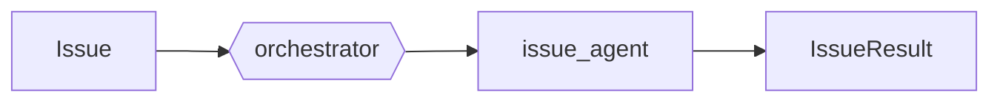
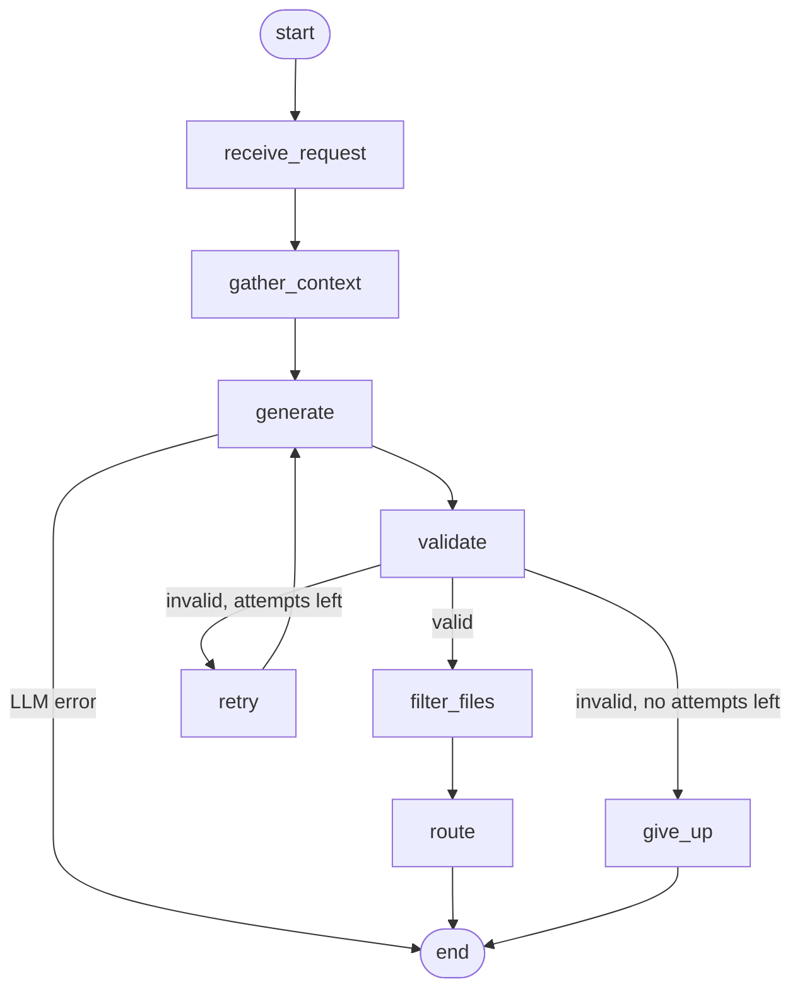

# AI Issue Agent

> Group 20 · SE373 Agentic Engineering · Project 01 (Phase 1)


-orange)

An agent system that reads a software issue, gathers evidence from a Python repo, and decides what to do
with it (answer, fix, implement, ask for more info, or reject).

**Phase 1 only classifies and routes issues.** It does not edit code or commit yet.

## Architecture

A LangGraph **orchestrator** receives each issue and hands it to a **subagent**. Today there is one
subagent, `issue_agent`, which is itself a LangGraph graph.



Inside `issue_agent`:



`gather_context` uses `list_files`, `search_code`, and `read_file` to collect evidence. `route` picks one of
`answer | fix | implement | ask_user | reject`.

## Quick start

Requires [uv](https://docs.astral.sh/uv/) and Python 3.11+. The web UI also needs Node 20+.

```bash
# Backend (from backend/)
cd backend
uv sync                                                  # creates .venv and installs everything

LLM_PROVIDER=fake uv run issue-agent-server              # API → http://127.0.0.1:8000
uv run issue-agent -t "<title>" -d "<description>" -r tests/fixtures/sample_repo --trace   # CLI
LLM_PROVIDER=fake uv run pytest                          # tests
LLM_PROVIDER=fake uv run python -m evals.runner          # eval suite

# Frontend (from frontend/)
cd ../frontend
npm install
npm run dev                                              # UI → http://localhost:5173 (proxies /api to :8000)
npm run build                                            # or build once; the backend then serves it at "/"
```

`LLM_PROVIDER=fake` is an offline test double. To use a real LLM, copy `backend/.env.example` to
`backend/.env`, put your API key in it, and let uv load it:

```bash
cd backend
cp .env.example .env              # then edit LLM_API_KEY
uv run --env-file .env issue-agent-server
```

`LLM_BASE_URL` points to any OpenAI-compatible server; the client calls `<base_url>/chat/completions`.

## Project layout

```text
.
├── backend/              Python agent system, CLI, REST API   → backend/README.md
│   ├── src/agent_system/
│   │   ├── orchestrator/   LangGraph orchestrator, process_issue entry point
│   │   ├── subagents/
│   │   │   └── issue_agent/  triage subagent: graph, prompts, skills, tools, validation
│   │   ├── core/           contracts, config, LLM client, trace
│   │   └── interfaces/     CLI, REST API, adapter
│   ├── evals/              14 eval cases + runner            → backend/evals/README.md
│   ├── examples/           sample repo + demo scripts
│   └── tests/              unit + integration tests
├── frontend/             React + Vite web UI                  → frontend/README.md
└── docs/                 technical docs & handovers
```

The two parts only meet at the HTTP API (`/api/*`).

## Status

- Unit + integration tests: **300 passed**
- Offline eval (`LLM_PROVIDER=fake`): **14/14**, type accuracy 11/11
- Live eval (user-run): 13/14 — case 07 still open

## Team (Phase 1)

| Member | Area | Scope |
|---|---|---|
| 1 | Contracts & Infra | `core/contracts.py`, `core/config.py`, `core/logging_config.py`, `orchestrator/`, CI |
| 2 | Agent Loop & LLM | `subagents/issue_agent/graph.py`, `core/llm/client.py`, `prompts.py`, retry |
| 3 | Repo Tools & Skill | `subagents/issue_agent/tools/*`, `skills/gather_context.py` |
| 4 | Validation & Routing | `subagents/issue_agent/validation/*`: schema, `affected_files`, routing |
| 5 | App & Evaluation | `interfaces/` (CLI, API), eval suite, integration tests, frontend |

## Docs

- [Backend](backend/README.md)
- [Frontend](frontend/README.md)
- [Eval suite](backend/evals/README.md)
- [ADR 01 — Tool interface](docs/decisions/01_tool_interface_agreement.md)
